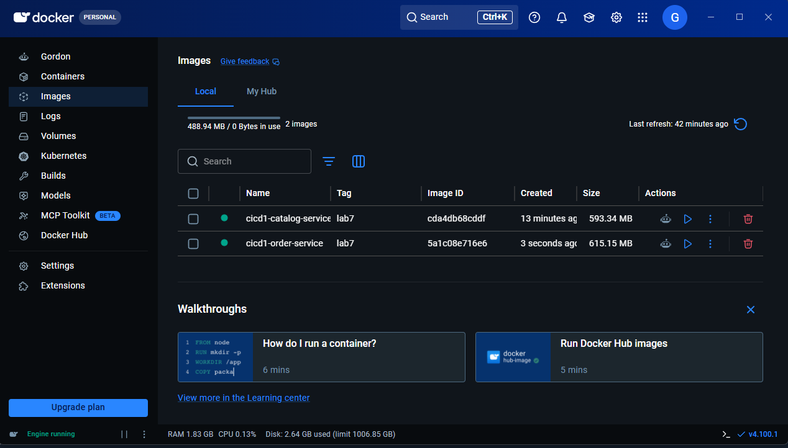

Order Service

This service lets you create orders and view all orders.

It runs on port 8082.

GET /orders — view all orders

POST /orders — create an order

Swagger: http://localhost:8082/swagger-ui/index.html

Orders are stored in memory and are cleared when the service stops. The
productId is for a product in the Catalog Service, but this service does not
connect to Catalog yet.
CICD-1 Lab 1 
 
Browser / Swagger 

       | 
       +--> Catalog Service :8081 --> temporary Product List<> 
       | 
       +--> Order Service   :8082 --> temporary Order List<> 
 
Separate GitHub repositories 
Separate open pull requests 
 
Week 2: add JPA + H2 
Week 3: add Order -> Catalog communication with OpenFeign 
## SQL and Normalisation Lab 
Final db<>fiddle session:
https://dbfiddle.uk/thZKs4T2  

Lab 7
1. Maven builds the JAR; Docker packages it into an image.
2. An image is the read-only packaged blueprint; a container is a runnable instance with its own writable layer.
3. It publishes host port 8082 to container port 8082. EXPOSE only documents the container port.
4. Inside Order’s container, localhost refers to Order itself. Catalog needs a reachable service address.
5. The named volume outlives the container and keeps the file-backed H2 data. In-memory data disappears when the process stops. 

    Catalog product retrieved: Product ID 1 — Lab 7 Compose persistence test

